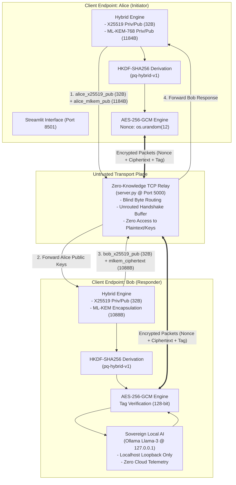

# 🛡️ Project Armadillo: Post-Quantum Zero-Knowledge Communications

[](https://github.com/waghmareayush1804-design/secure-chat/actions/workflows/ci.yml)
[](https://www.python.org/)
[](https://csrc.nist.gov/pubs/fips/203/final)
[](LICENSE)

An end-to-end encrypted, zero-knowledge communication system designed to neutralize **Harvest Now, Decrypt Later (HNDL)** attacks through a hybrid cryptographic exchange combining **NIST FIPS 203 (ML-KEM-768)** and classical **X25519 (ECDH)**, sealed with **AES-256-GCM**, routed through a blind TCP relay, and integrated with sovereign local AI inference.

---

## 1. Problem Statement

Adversaries, hostile states, and corporate espionage operations routinely intercept, record, and archive vast volumes of encrypted public and private network communications. Although this data is protected by classical cryptography (RSA, ECDH, Diffie-Hellman) today, the emergence of **Cryptographically Relevant Quantum Computers (CRQCs)** running **Shor's Algorithm** will render discrete logarithms and prime factorization solvable in polynomial time $\mathcal{O}((\log N)^3)$. 

Under this **Harvest Now, Decrypt Later (HNDL)** attack vector, every piece of data protected solely by classical public-key cryptography and archived today is already compromised in the future.

---

## 2. Goals and Objectives

1. **Quantum Immunity:** Implement NIST FIPS 203 lattice-based Module Learning With Errors ($M\text{-LWE}$) to ensure post-quantum resistance against Shor's algorithm.
2. **Dual-Layer Defense:** Combine quantum-resistant ML-KEM-768 with classical X25519 ECDH via HKDF-SHA256 to guarantee that breaking the session key requires simultaneously breaking both classical elliptic curves and lattice mathematics.
3. **Zero-Knowledge Transport:** Ensure the central relay router is entirely blind—it routes opaque byte streams without access to shared secrets, public keys, or message metadata.
4. **Air-Gapped Sovereign AI:** Integrate local AI reasoning (Llama-3 via local Ollama daemon) on the receiving endpoint (`Bob`), guaranteeing that decrypted plaintext prompts never leak to commercial cloud backbones or third-party servers.

---

## 3. Key Features

- **Hybrid Key Encapsulation (FIPS 203 + RFC 7748):** Deterministic dual-layer key exchange combining `ML-KEM-768` (1184-byte public key) and `X25519` (32-byte public key).
- **Dual-Secret HKDF Extraction:** SHA-256 HKDF extracts a single high-entropy 256-bit symmetric session key (`pq-hybrid-v1`).
- **AES-256-GCM Authenticated Encryption:** Every packet is protected by a fresh 96-bit CSPRNG initialization vector (`os.urandom(12)`) and verified against a 128-bit GHASH authentication tag.
- **Blind TCP Relay with Handshake Buffering:** A lightweight, non-inspecting router that transparently buffers initial handshake bytes when peers connect asynchronously, eliminating connection race conditions.
- **Cryptographic Telemetry UI:** A real-time Streamlit dashboard visualizing session key fingerprints, nonce generation, ciphertext lengths, and decrypted outputs.
- **Graceful Local AI Fallback:** Automated endpoint (`Bob`) responds via local Llama-3 when available, and provides informative offline receipts when the daemon is unreachable.
- **LSB Steganography Engine:** Standalone bit-level steganography utility capable of embedding sensitive payloads into RGB images.

---

## 4. Architecture Overview



For detailed protocol specifications and sequence diagrams, see [docs/architecture.md](docs/architecture.md).  
For the mathematical threat model and quantum resistance analysis, see [docs/threat_model.md](docs/threat_model.md).

---

## 5. Technology Stack

- **Language:** Python 3.11+ (Tested on Python 3.11, 3.12, 3.13, 3.14)
- **Cryptography:** [`cryptography>=44.0.0`](https://cryptography.io/) (OpenSSL 3.2+ backend with native `MLKEM768`, `X25519`, `HKDF`, `AESGCM`)
- **Frontend / Telemetry UI:** [Streamlit](https://streamlit.io/)
- **Local AI Inference:** [LangChain Ollama](https://github.com/langchain-ai/langchain) + [Ollama](https://ollama.com/)
- **Steganography:** [Pillow (PIL)](https://pillow.readthedocs.io/)
- **Testing:** Standard Library `unittest` / `pytest`
- **Automation / Task Runner:** GNU `make`

---

## 6. Repository Structure

```
secure-chat/
├── .github/
│   ├── ISSUE_TEMPLATE/
│   │   ├── bug_report.yml
│   │   └── feature_request.yml
│   ├── workflows/
│   │   └── ci.yml
│   ├── PULL_REQUEST_TEMPLATE.md
│   └── dependabot.yml
├── docs/
│   ├── architecture.md          # Protocol diagrams and wire formatting
│   ├── threat_model.md          # HNDL analysis, Shor's algorithm, lattice hardness
│   ├── development.md           # Setup, test execution, style guidelines
│   ├── deployment.md            # systemd services, Docker, network hardening
│   └── troubleshooting.md       # Operational debugging and common errors
├── pages/
│   └── 1_Chat_Terminal.py       # Streamlit encrypted chat & cryptographic telemetry
├── scripts/
│   ├── run_relay.sh             # Launch blind TCP relay server
│   ├── run_alice.sh             # Launch Streamlit operator terminal
│   ├── run_bob.sh               # Launch headless Bob AI responder
│   └── run_tests.sh             # Run automated unit test suite
├── tests/
│   ├── __init__.py
│   ├── test_crypto_client.py    # Hybrid key exchange, HKDF, AES-GCM, tamper detection
│   ├── test_server.py           # Relay routing, handshake queueing, disconnect handling
│   ├── test_bob_agent.py        # Bob automated agent and Ollama fallback
│   └── test_steganography.py    # LSB image encoding and decoding roundtrips
├── .editorconfig                # Universal indentation and style rules
├── .env.example                 # Safe environment configuration template
├── .gitattributes               # Line ending normalization and binary flags
├── .gitignore                   # Comprehensive Python/Streamlit ignore rules
├── .pre-commit-config.yaml      # Pre-commit hooks for linting and formatting
├── CHANGELOG.md                 # Keep a Changelog version history
├── CODE_OF_CONDUCT.md           # Contributor Covenant v2.1
├── CONTRIBUTING.md               # Contribution workflow and guidelines
├── Home.py                      # Streamlit application landing page & threat model
├── LICENSE                      # Proprietary notice pending licensing decision
├── Makefile                     # Developer task runner (make test, make lint)
├── README.md                    # Primary project documentation
├── SECURITY.md                  # Vulnerability disclosure and reporting policy
├── bob_agent.py                 # Automated responder connection supervisor
├── bob_ai.py                    # Bob AI endpoint with Ollama integration
├── crypto_client.py             # SecureClient cryptographic engine
├── pyproject.toml               # PEP 621 package and tool metadata
├── requirements.txt             # Pinned production dependencies
├── requirements-dev.txt         # Development and testing dependencies
├── server.py                    # Zero-knowledge TCP blind relay server
└── stegno code.py               # LSB image steganography utility
```

---

## 7. Prerequisites and Supported Environments

- **Operating System:** Linux (Ubuntu 22.04+, Fedora 39+, Debian 12+), macOS 13+, or Windows 11 (WSL2 recommended).
- **Python:** Version 3.11 or newer.
- **Hardware:** Minimum 2 GB RAM (8 GB+ recommended if running local Llama-3 with Ollama).

---

## 8. Installation and Setup

### 8.1 Clone the Repository
```bash
git clone https://github.com/waghmareayush1804-design/secure-chat.git
cd secure-chat
```

### 8.2 Create and Activate Virtual Environment
```bash
python3 -m venv .venv
source .venv/bin/activate
```

### 8.3 Install Dependencies
```bash
# Install runtime requirements:
pip install -r requirements.txt

# Or install development requirements (including pytest and ruff):
pip install -r requirements-dev.txt
```

### 8.4 Environment Configuration
Copy the configuration template:
```bash
cp .env.example .env
```
Default parameters are pre-configured for local loopback operation (`127.0.0.1:5000`).

---

## 9. Running the Application

Running the complete end-to-end system requires three processes:

### Step 1: Start the Blind Relay Server
```bash
./scripts/run_relay.sh
# Or directly: python3 server.py
```
*Expected Output:*
```
2026-10-23 21:00:00 [INFO] Zero-knowledge relay listening on 127.0.0.1:5000
```

### Step 2: Start Bob's AI Responder
In a second terminal:
```bash
./scripts/run_bob.sh
# Or directly: python3 bob_ai.py
```
*Expected Output:*
```
[Bob] Connecting to the encrypted relay on 127.0.0.1:5000...
[Bob] Connected and responder handshake completed.
```
*(Note: If Ollama is not installed or running, Bob will operate in graceful offline fallback mode).*

### Step 3: Launch Alice's Streamlit Operator Terminal
In a third terminal:
```bash
./scripts/run_alice.sh
# Or directly: streamlit run Home.py
```
Navigate your browser to `http://localhost:8501`, click **Launch Secure Terminal**, and begin exchanging post-quantum encrypted messages.

---

## 10. Running Automated Tests

Project Armadillo includes 16 comprehensive unit tests verifying cryptographic primitives, TCP streaming reassembly, network relaying, and responder agents:

```bash
# Using Make:
make test

# Using the test wrapper:
./scripts/run_tests.sh

# Directly with Python:
python3 -m unittest discover -s tests -p "test_*.py" -v
```

### Test Coverage Highlights
- ✅ **`test_direct_crypto_primitives`**: Verifies X25519, ML-KEM-768 encapsulation/decapsulation, and HKDF-SHA256 secret mixing.
- ✅ **`test_tamper_detection`**: Simulates bit-flipping on ciphertexts and nonces, confirming AES-GCM tag verification failure.
- ✅ **`test_rapid_successive_messages`**: Confirms that rapid back-to-back messaging without pauses maintains framing boundaries and decrypts without corruption.
- ✅ **`test_large_message_payload`**: Validates deterministic reassembly and decryption of messages exceeding TCP socket buffer sizes (>60 KB).
- ✅ **`test_network_tamper_resilience`**: Verifies that network tampering alerts the receiver without terminating the persistent connection.
- ✅ **`test_buffering_for_subsequent_peer`**: Confirms that initial handshakes sent before peer arrival are buffered and delivered without race conditions.
- ✅ **`test_hybrid_handshake_and_secure_messaging`**: Full end-to-end socket handshake and bidirectional encrypted messaging.
- ✅ **`test_generate_response_offline_fallback`**: Verifies Bob handles offline Ollama daemons without unhandled exceptions.
- ✅ **`test_encode_and_decode_roundtrip`**: Validates LSB steganography roundtrips on synthetic images.

---

## 11. Environment Variables Reference

| Variable | Default | Purpose |
|---|---|---|
| `RELAY_HOST` | `127.0.0.1` | IP address or interface the blind TCP relay binds to. |
| `RELAY_PORT` | `5000` | Port used by the TCP relay for opaque byte transmission. |
| `STREAMLIT_PORT` | `8501` | HTTP port for the Streamlit user interface. |
| `OLLAMA_MODEL` | `llama3` | Ollama model tag invoked by the Bob responder. |
| `LOG_LEVEL` | `INFO` | Relay logging verbosity (`DEBUG`, `INFO`, `WARNING`, `ERROR`). |

---

## 12. Security Considerations & Disclosure

- **Ephemeral Keys:** Fresh X25519 and ML-KEM-768 key pairs are generated for every session.
- **Nonce Monotonicity:** AES-GCM nonces are generated per message via CSPRNG (`os.urandom(12)`).
- **Compromise Boundary:** The relay server is assumed to be running on an untrusted or monitored host; it never possesses symmetric keys, private keys, or plaintext.
- **Responsible Disclosure:** For vulnerability reports, please review our [SECURITY.md](SECURITY.md) policy.

---

## 13. License

Copyright (c) 2026 Ayush Nitin Waghmare. All Rights Reserved.  
See [LICENSE](LICENSE) for terms.

---

## 14. Lead Architect & Maintainer

- **Architect:** Ayush Nitin Waghmare
- **Institution:** Symbiosis Artificial Intelligence Institute
- **Contact:** `ayush.waghmare.bsc2025@saii.siu.edu.in`
