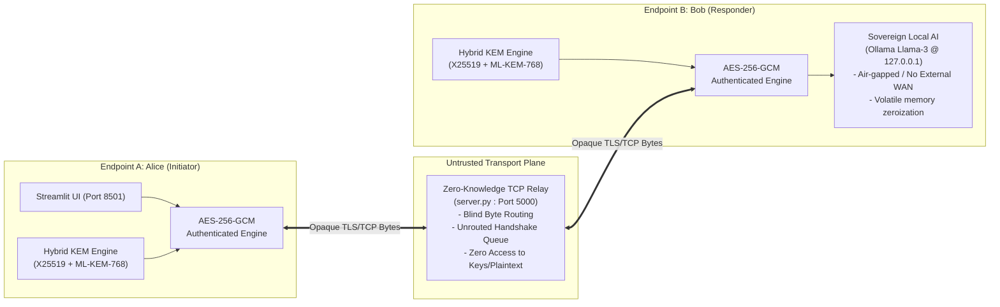
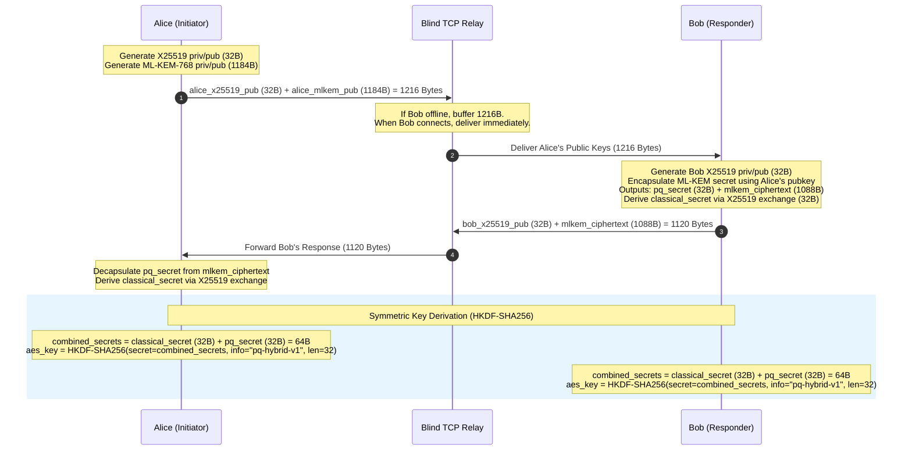

# Project Armadillo: Architectural Specification

## 1. Executive Overview

**Project Armadillo** is an end-to-end encrypted, zero-knowledge communications architecture engineered to defend against **Harvest Now, Decrypt Later (HNDL)** adversary operations. By establishing a dual-secret hybrid key exchange combining classical elliptic curves (**X25519**) and lattice-based post-quantum cryptography (**ML-KEM-768 / FIPS 203**), Armadillo ensures that intercepted ciphertexts remain computationally infeasible to decrypt by both classical computers and future Cryptographically Relevant Quantum Computers (CRQCs).

---

## 2. Zero-Knowledge Topology



---

## 3. Cryptographic Key Exchange Sequence



---

## 4. Packet Framing and Authenticated Encryption

Every application payload transmitted across the relay is framed with a 4-byte big-endian length prefix and sealed with **AES-256-GCM** (Galois/Counter Mode).

### Packet Wire Format
```
+--------------------+-------------------+-------------------------------+---------------------+
| Length (4B BigEnd) |  Nonce (12 Bytes) |  Ciphertext (Variable Length)  | Auth Tag (16 Bytes) |
+--------------------+-------------------+-------------------------------+---------------------+
```

1. **Length-Prefixed Framing (`>I`):** Guarantees deterministic TCP byte-stream reassembly across high-latency WAN links, preventing packet coalescing and fragmentation desynchronization.
2. **Nonce Generation:** A fresh, cryptographically secure random 96-bit (12-byte) initialization vector is generated for every transmission using the operating system CSPRNG (`os.urandom(12)`).
3. **GHASH Integrity Tag:** The 128-bit authentication tag guarantees confidentiality and authenticity. Any modification in transit triggers immediate client-side rejection and a tamper alert without killing the client socket loop.
4. **Replay & Malleability Resistance:** Because nonces are unique and tags are strictly verified prior to plaintext decoding, ciphertext manipulation is detected with overwhelming probability ($1 - 2^{-128}$).

---

## 5. Component Responsibilities

| Component | File | Responsibilities |
|---|---|---|
| **Streamlit UI** | [`Home.py`](file:///home/ayushwaghmare/secure-chat/Home.py), [`pages/1_Chat_Terminal.py`](file:///home/ayushwaghmare/secure-chat/pages/1_Chat_Terminal.py) | Human operator interface, cryptographic session telemetry display, real-time message exchange, connection state indicator. |
| **Crypto Client** | [`crypto_client.py`](file:///home/ayushwaghmare/secure-chat/crypto_client.py) | Key pair generation, encapsulation/decapsulation, HKDF extraction, AES-GCM encryption/decryption, background socket receive thread. |
| **Blind TCP Relay** | [`server.py`](file:///home/ayushwaghmare/secure-chat/server.py) | Stateless/opaque packet routing, connection isolation, unrouted handshake queueing for asynchronous peer arrival. |
| **Headless AI Responder** | [`bob_ai.py`](file:///home/ayushwaghmare/secure-chat/bob_ai.py), [`bob_agent.py`](file:///home/ayushwaghmare/secure-chat/bob_agent.py) | Automated autonomous endpoint with local Ollama Llama-3 integration and graceful offline fallback. |
| **LSB Steganography** | [`stegno code.py`](file:///home/ayushwaghmare/secure-chat/stegno%20code.py) | In-memory and file-based LSB image encoding and decoding for covert data storage. |
